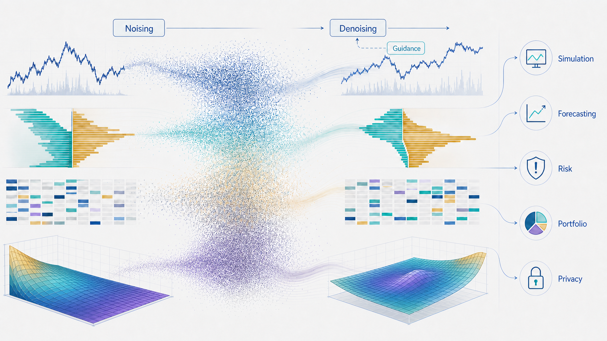

# Awesome Diffusion Models in Finance Papers

A curated list of papers on learned generative diffusion, flow, and closely related stochastic-interpolant models for finance.

## Scope

Included papers should use a learned diffusion/flow generator, or make a finance-specific contribution that directly evaluates such models. Classical financial "diffusion" in the SDE/PDE sense is not included unless the paper also contains a learned generative diffusion or flow model. Related time-series, tabular, decision-making, and non-diffusion finance generators are listed separately as background or baselines. Within each category, papers are ordered by year and then alphabetically by first author name.



Finance-facing entries use compact domain tags in the format `Region / Asset / Data`:

- `Region`: the market or dataset region, such as `US`, `CN`, `HK`, `JP`, or `Multi`.
- `Asset`: the traded asset, financial instrument, or record type, such as `Stock`, `Option`, `Future`, `ETF`, `Credit`, or `Payment`.
- `Data`: the financial data representation used by the diffusion model, such as `Price series`, `Return series`, `Orderflow`, `Correlation matrix`, `IV surface`, or `Yield curve`.

Use `Global` for general methods, `Synthetic` for simulated-only data, and `Unknown` when the paper does not specify the market region, asset, or data representation clearly.

## Contents

- [Surveys and Resources](#surveys-and-resources)
- [Financial Time Series Data](#financial-time-series-data)
  - [Unconditional Generation](#unconditional-generation)
  - [Conditional Generation](#conditional-generation)
  - [Prediction and Trading](#prediction-and-trading)
- [Limit Order Book Data](#limit-order-book-data)
  - [Orderflow Generation](#orderflow-generation)
  - [Orderbook Generation](#orderbook-generation)
- [Tabular Data](#tabular-data)
  - [Synthesis and Augmentation](#synthesis-and-augmentation)
  - [Privacy and Trustworthiness](#privacy-and-trustworthiness)
- [Structured Financial Objects](#structured-financial-objects)
- [Related Foundations and Backbones](#related-foundations-and-backbones)
- [Contributing](#contributing)

## Related Surveys and Resources

- Large Language Models in Finance: A Survey, ICAIF 2023. [paper](https://arxiv.org/abs/2311.10723)
- Diffusion Models for Reinforcement Learning: A Survey, arXiv 2023. [paper](https://arxiv.org/abs/2311.01223) [list](https://github.com/apexrl/diff4rlsurvey)
- Synthetic Data Applications in Finance, arXiv 2024. [paper](https://arxiv.org/abs/2401.00081)
- Diffusion and Flow Matching Models for Tabular Data: A Survey, arXiv 2025. [paper](https://arxiv.org/abs/2502.17119) [list](https://github.com/Diffusion-Model-Leiden/awesome-diffusion-models-for-tabular-data)
- Large Language Model Agents for Investment Management: Foundations, Benchmarks, and Research Frontiers, ICAIF 2025. [paper](https://doi.org/10.1145/3768292.3770387)
- A Survey on Diffusion Models for Time Series and Spatio-Temporal Data, ACM Computing Surveys 2026. [paper](https://arxiv.org/abs/2404.18886) [journal](https://doi.org/10.1145/3783986) [list](https://github.com/yyysjz1997/Awesome-TimeSeries-SpatioTemporal-Diffusion-Model)

## Financial Time Series Data

### Unconditional Generation

- Beyond Monte Carlo: Harnessing Diffusion Models to Simulate Financial Market Dynamics, arXiv 2024. US / Stock / Return vectors. [paper](https://arxiv.org/abs/2412.00036)
- Synthetic Asset Price Paths Generation Using Denoising Diffusion Probabilistic Model, SCML 2024. Synthetic / Stock, Option / Price series. [paper](https://scml.jp/2024/paper/8/CameraReady/scml2024.pdf)
- Diffusion Factor Models: Generating High-Dimensional Returns with Factor Structure, arXiv 2025. US / Stock / Return series. [paper](https://arxiv.org/abs/2504.06566) [code](https://github.com/xymmmm00/diffusion_factor_model)
- A diffusion-based generative model for financial time series via geometric Brownian motion, arXiv 2025. US / Stock / Price series. [paper](https://arxiv.org/abs/2507.19003)
- Fiaingen: A Financial Time Series Generative Method Matching Real-World Data Quality, arXiv 2025. Multi / Stock / Price series. [paper](https://arxiv.org/abs/2510.01169)
- Generation of Synthetic Financial Time Series by Diffusion Models, Quantitative Finance 2025. US / Stock / Return & Volume series. [paper](https://arxiv.org/abs/2410.18897)
- High-Quality Synthetic Financial Time-Series using a GAN-Diffusion Framework, arXiv 2026. US / Stock / Price series & Volume. [paper](https://arxiv.org/abs/2605.27113)

### Conditional Generation

- Multi-Agent Regime-Conditioned Diffusion (MARCD) for CVaR-Constrained Portfolio Decisions, arXiv 2025. US / ETF / Return series. [paper](https://arxiv.org/abs/2510.10807)
- Diffusion-Augmented Reinforcement Learning for Robust Portfolio Optimization under Stress Scenarios, NeurIPS 2025 Workshop on Generative AI in Finance. US / Stock / Return series. [paper](https://arxiv.org/abs/2510.07099) [record](https://nips.cc/virtual/2025/132534)
- Diffusion Generative Models Meet Compressed Sensing, with Applications to Imaging and Finance, arXiv 2025. US / Stock, Macro / Price series. [paper](https://arxiv.org/abs/2509.03898) [code](https://github.com/ZhengyiGuo2002/CSDM-code)
- InterDiff: Synthesizing Financial Time Series with Inter-Stock Correlations via Classifier-Free Guided Diffusion, ECML-PKDD 2025. CN / Stock / Price series. [paper](https://link.springer.com/chapter/10.1007/978-3-032-06118-8_13)
- CoFinDiff: Controllable Financial Diffusion Model for Time Series Generation, IJCAI 2025. JP / Stock / Price series. [paper](https://arxiv.org/abs/2503.04164)
- Diffusion-Based Scenario Tree Generation for Multivariate Time Series Prediction and Multistage Stochastic Optimization, arXiv 2025. US / Energy / Price series. [paper](https://arxiv.org/abs/2509.14832)

### Prediction and Trading

- Diffusion Variational Autoencoder for Tackling Stochasticity in Multi-Step Regression Stock Price Prediction, CIKM 2023. US / Stock / Price series. [paper](https://dl.acm.org/doi/10.1145/3583780.3614915) [code](https://github.com/kentang2017/diffusion-vae)
- DiffSTOCK: Probabilistic Relational Stock Market Predictions using Diffusion Models, ICASSP 2024. US / Stock / Price series. [paper](https://arxiv.org/abs/2403.14063)
- A Spatio-Temporal Diffusion Model for Missing and Real-Time Financial Data Inference, CIKM 2024. US / Stock / Firm-characteristic panel. [paper](https://doi.org/10.1145/3627673.3679806) [record](https://papers.ssrn.com/sol3/papers.cfm?abstract_id=5104672)
- DiffsFormer: A Diffusion Transformer on Stock Factor Augmentation, arXiv 2024. CN / Stock / Price series. [paper](https://arxiv.org/abs/2402.06656)
- A Financial Time Series Denoiser Based on Diffusion Models, ICAIF 2024. US / Stock / Price series. [paper](https://doi.org/10.1145/3677052.3698649) [arXiv](https://arxiv.org/abs/2409.02138)
- Solving Dynamic Portfolio Selection Problems via Score-Based Diffusion Models, arXiv 2025. US / Stock / Return series. [paper](https://arxiv.org/abs/2507.09916)
- DHMoE: Diffusion Generated Hierarchical Multi-Granular Expertise for Stock Prediction, AAAI 2025. US, CN, HK / Stock / Price series. [paper](https://ojs.aaai.org/index.php/AAAI/article/view/33250)
- Factor-Based Conditional Diffusion Model for Contextual Portfolio Optimization, arXiv 2025. CN / Stock / Return series. [paper](https://arxiv.org/abs/2509.22088)
- Exploring Diffusion Models for Generative Forecasting of Financial Charts, arXiv 2025. Global / Bitcoin Future / Price series. [paper](https://arxiv.org/abs/2509.02308)
- FlowHFT: Imitation Learning via Flow Matching Policy for Optimal High-Frequency Trading under Diverse Market Conditions, arXiv 2025. Synthetic / Stock / Synthetic data. [paper](https://arxiv.org/abs/2505.05784)
- Factor Dimensionality and the Bias-Variance Tradeoff in Diffusion Portfolio Models, ICLR 2026 TSALM Workshop. US / Stock / Return series. [paper](https://arxiv.org/abs/2603.10385) [record](https://openreview.net/forum?id=hv6A1DRJ17)
- Diffolio: A Diffusion Model for Multivariate Probabilistic Financial Time-Series Forecasting and Portfolio Construction, Information Fusion 2026. US / Stock / Return series. [paper](https://arxiv.org/abs/2511.07014)
- VARDiff: Vision-augmented retrieval-guided diffusion for stock forecasting, Information Sciences 2026. US / Stock / Price series. [paper](https://doi.org/10.1016/j.ins.2026.123113)

## Limit Order Book Data

### Orderflow Generation

- TRADES: Generating Realistic Market Simulations with Diffusion Models, ECAI 2025. US / Stock / LOB orderflow. [paper](https://arxiv.org/abs/2502.07071) [code](https://github.com/LeonardoBerti00/DeepMarket)
- ByteGen: A Tokenizer-Free Generative Model for Orderbook Events in Byte Space, arXiv 2025. US / Bitcoin Future / LOB orderflow. [paper](https://arxiv.org/abs/2508.02247)
- Controllable Financial Market Generation with Diffusion Guided Meta Agent, AAAI 2026. CN / Stock / LOB orderflow. [paper](https://arxiv.org/abs/2408.12991) [code](https://github.com/microsoft/TimeCraft)
- Limit Order Book Event Stream Prediction with Diffusion Model, Data Science and Engineering 2026. US, CN / Stock / LOB orderflow. [paper](https://arxiv.org/abs/2412.09631) [code](https://github.com/zhengzetao/LOBDIF)

### Orderbook Generation

- Painting the Market: Generative Diffusion Models for Financial Limit Order Book Simulation and Forecasting, arXiv 2025. US / Stock / LOB snapshots. [paper](https://arxiv.org/abs/2509.05107)
- DiffVolume: Diffusion Models for Volume Generation in Limit Order Books, ICAIF 2025. US / Stock / LOB volume. [paper](https://arxiv.org/abs/2508.08698)
- DiffLOB: Diffusion Models for Counterfactual Generation in Limit Order Books, IJCAI-ECAI 2026. US / Stock / LOB snapshots. [paper](https://arxiv.org/abs/2602.03776) [record](https://kclpure.kcl.ac.uk/portal/en/publications/difflob-diffusion-models-for-counterfactual-generation-in-limit-o/) [code](https://github.com/ZhuoHan1998/DiffLOB)
- FlowLOB: Efficient and Controllable Limit Order Book Generation with Flow Matching, ICAIF 2026. HK / Stock / LOB trajectories. [paper](https://arxiv.org/abs/2608.13096) [record](https://kclpure.kcl.ac.uk/portal/en/publications/flowlob-efficient-and-controllable-limit-order-book-generation-wi/)

## Tabular Data

### Synthesis and Augmentation

- FinDiff: Diffusion Models for Financial Tabular Data Generation, ICAIF 2023. Multi / Credit, Payment, Fund / Tabular. [paper](https://arxiv.org/abs/2309.01472) [code](https://github.com/sattarov/FinDiff)
- Entity-based Financial Tabular Data Synthesis with Diffusion Models, ICAIF 2024. Multi / Finance / Tabular. [paper](https://doi.org/10.1145/3677052.3698625)
- Synthetic Data Generation for Fraud Detection Using Diffusion Models, Information and Security 2024. Multi / Fraud / Tabular. [paper](https://www.isij.eu/article/synthetic-data-generation-fraud-detection-using-diffusion-models)
- Imb-FinDiff: Conditional Diffusion Models for Class Imbalance Synthesis of Financial Tabular Data, ICAIF 2024. Multi / Finance / Tabular. [paper](https://doi.org/10.1145/3677052.3698659)
- Boosting Predictive Performance on Tabular Data through Data Augmentation with Latent-Space Flow-Based Diffusion, arXiv 2025. Multi / Credit, Customer / Tabular. [paper](https://arxiv.org/abs/2511.16571)
- EmDT: Embedding Diffusion Transformer for Tabular Data Generation in Fraud Detection, arXiv 2026. Multi / Fraud / Tabular. [paper](https://arxiv.org/abs/2603.13566)

### Privacy and Trustworthiness

- Federated Diffusion Modeling with Differential Privacy for Tabular Data Synthesis, arXiv 2024. Global / Finance / Tabular. [paper](https://arxiv.org/abs/2412.16083)
- Privacy Preserving Diffusion Models for Mixed-Type Tabular Data Generation, arXiv 2025. Multi / Finance / Tabular. [paper](https://arxiv.org/abs/2512.00638) [code](https://github.com/sattarov/DP-FinDiff)
- Constrained Tabular Diffusion for Finance, ICAIF 2025 / arXiv 2026. Multi / Finance / Tabular. [paper](https://arxiv.org/abs/2606.28674)
- Tabular diffusion counterfactual explanations, Frontiers in Artificial Intelligence 2026. Global / Credit / Tabular. [paper](https://doi.org/10.3389/frai.2026.1743495)
- Measuring Privacy Risks and Tradeoffs in Financial Synthetic Data Generation, arXiv 2026. Multi / Finance / Tabular. [paper](https://arxiv.org/abs/2602.09288)

## Structured Financial Objects

Correlation matrices, volatility surfaces, yield curves, and derivative paths:

- Denoising Diffusion Probabilistic Model for Realistic Financial Correlation Matrices, ICAIF 2024. US / Stock / Correlation matrix. [paper](https://doi.org/10.1145/3677052.3698640) [code](https://github.com/szymkubiak/DDPM-for-Correlation-Matrices)
- Generating Solution Paths of Markovian Stochastic Differential Equations using Diffusion Models, arXiv 2025. US / Stock / Price series. [paper](https://arxiv.org/abs/2509.08731)
- Forecasting Implied Volatility Surface with Generative Diffusion Models, arXiv 2025. US / Option / IV surface. [paper](https://arxiv.org/abs/2511.07571) [code](https://github.com/Austinjinc/diffusion-paper-code)
- Valuation of Exotic Options and Counterparty Games Based on Conditional Diffusion, arXiv 2025. Global / Option / Price series. [paper](https://arxiv.org/abs/2509.13374)
- Generating the Term Structure of Interest Rates with Diffusion Models, Expert Systems with Applications 2026. JP / Interest rate / Yield curve. [paper](https://doi.org/10.1016/j.eswa.2026.132895)
- Generative Diffusion Model for Risk-Neutral Derivative Pricing, arXiv 2026. Global / Stock / Return series. [paper](https://arxiv.org/abs/2603.20582)
- TF-CoDiT: Conditional Time Series Synthesis with Diffusion Transformers for Treasury Futures, arXiv 2026. CN / Treasury Future / Price series. [paper](https://arxiv.org/abs/2601.11880)

## Related Foundations and Backbones

Diffusion and score-based modeling:

- Deep Unsupervised Learning using Nonequilibrium Thermodynamics, ICML 2015. [paper](https://arxiv.org/abs/1503.03585) [code](https://github.com/Sohl-Dickstein/Diffusion-Probabilistic-Models)
- Generative Modeling by Estimating Gradients of the Data Distribution, NeurIPS 2019. [paper](https://arxiv.org/abs/1907.05600) [code](https://github.com/ermongroup/ncsn)
- Denoising Diffusion Probabilistic Models, NeurIPS 2020. [paper](https://arxiv.org/abs/2006.11239) [code](https://github.com/hojonathanho/diffusion)
- Diffusion Models Beat GANs on Image Synthesis, NeurIPS 2021. [paper](https://arxiv.org/abs/2105.05233) [code](https://github.com/openai/guided-diffusion)
- Classifier-Free Diffusion Guidance, NeurIPS 2021 Workshop on Deep Generative Models and Downstream Applications. [paper](https://arxiv.org/abs/2207.12598) [record](https://nips.cc/virtual/2021/48591)
- Improved Denoising Diffusion Probabilistic Models, ICML 2021. [paper](https://arxiv.org/abs/2102.09672) [code](https://github.com/openai/improved-diffusion)
- Denoising Diffusion Implicit Models, ICLR 2021. [paper](https://arxiv.org/abs/2010.02502) [code](https://github.com/ermongroup/ddim)
- Score-Based Generative Modeling through Stochastic Differential Equations, ICLR 2021. [paper](https://arxiv.org/abs/2011.13456) [code](https://github.com/yang-song/score_sde)
- Elucidating the Design Space of Diffusion-Based Generative Models, NeurIPS 2022. [paper](https://arxiv.org/abs/2206.00364) [code](https://github.com/NVlabs/edm)
- Consistency Models, ICML 2023. [paper](https://arxiv.org/abs/2303.01469) [code](https://github.com/openai/consistency_models)

Flow matching, rectified flow, and stochastic interpolants:

- Flow Straight and Fast: Learning to Generate and Transfer Data with Rectified Flow, ICLR 2023. [paper](https://arxiv.org/abs/2209.03003) [code](https://github.com/gnobitab/RectifiedFlow)
- Probabilistic Forecasting with Stochastic Interpolants and Follmer Processes, ICML 2024. [paper](https://arxiv.org/abs/2403.13724) [code](https://github.com/interpolants/forecasting)
- Recurrent Interpolants for Probabilistic Time Series Prediction, NeurIPS 2024 Workshop on Table Representation Learning. [paper](https://arxiv.org/abs/2409.11684) [record](https://nips.cc/virtual/2024/103136)
- FlowTS: Time Series Generation via Rectified Flow, arXiv 2024. [paper](https://arxiv.org/abs/2411.07506) [code](https://github.com/UNITES-Lab/FlowTS)
- Stochastic Interpolants: A Unifying Framework for Flows and Diffusions, JMLR 2025. [paper](https://arxiv.org/abs/2303.08797) [journal](https://jmlr.org/beta/papers/v26/23-1605.html) [code](https://github.com/malbergo/stochastic-interpolants)
- RecTable: Fast Modeling Tabular Data with Rectified Flow, arXiv 2025. [paper](https://arxiv.org/abs/2503.20731) [code](https://github.com/fmp453/rectable)
- TimeFlow: Towards Stochastic-Aware and Efficient Time Series Generation via Flow Matching Modeling, arXiv 2025. [paper](https://arxiv.org/abs/2511.07968) [code](https://github.com/PanJingHe/TimeFlow)

Time-series and tabular backbones:

- Autoregressive Denoising Diffusion Models for Multivariate Probabilistic Time Series Forecasting, ICML 2021. [paper](https://arxiv.org/abs/2101.12072) [code](https://github.com/zalandoresearch/pytorch-ts)
- CSDI: Conditional Score-based Diffusion Models for Probabilistic Time Series Imputation, NeurIPS 2021. [paper](https://arxiv.org/abs/2107.03502) [code](https://github.com/ermongroup/CSDI)
- Diffusion-based Time Series Imputation and Forecasting with Structured State Space Models, TMLR 2022. [paper](https://arxiv.org/abs/2208.09399) [code](https://github.com/AI4HealthUOL/SSSD)
- Predict, Refine, Synthesize: Self-Guiding Diffusion Models for Probabilistic Time Series Forecasting, NeurIPS 2023. [paper](https://arxiv.org/abs/2307.11494) [code](https://github.com/amazon-science/unconditional-time-series-diffusion)
- TabDDPM: Modelling Tabular Data with Diffusion Models, ICML 2023. [paper](https://arxiv.org/abs/2209.15421) [code](https://github.com/yandex-research/tab-ddpm)
- Diffusion-TS: Interpretable Diffusion for General Time Series Generation, ICLR 2024. [paper](https://arxiv.org/abs/2403.01742) [code](https://github.com/Y-debug-sys/Diffusion-TS)
- Mixed-Type Tabular Data Synthesis with Score-based Diffusion in Latent Space, ICLR 2024. [paper](https://arxiv.org/abs/2310.09656) [code](https://github.com/amazon-science/tabsyn)
- DS-Diffusion: Data Style-Guided Diffusion Model for Time-Series Generation, arXiv 2025. [paper](https://arxiv.org/abs/2509.18584)

Decision-making and control:

- Planning with Diffusion for Flexible Behavior Synthesis, ICML 2022. [paper](https://arxiv.org/abs/2205.09991) [code](https://github.com/jannerm/diffuser)
- Is Conditional Generative Modeling all you need for Decision-Making?, ICLR 2023. [paper](https://arxiv.org/abs/2211.15657) [code](https://github.com/anuragajay/decision-diffuser/tree/main/code)
- Diffusion Models for Reinforcement Learning: A Survey, arXiv 2023. [paper](https://arxiv.org/abs/2311.01223) [code](https://github.com/apexrl/Diff4RLSurvey)
- An Optimal Control Perspective on Diffusion-Based Generative Modeling, TMLR 2024. [paper](https://arxiv.org/abs/2211.01364) [code](https://github.com/juliusberner/sde_sampler)


## Contributing

Please open an issue or pull request if a paper is missing, miscategorized, or no longer current.

Preferred entry format:

```markdown
- Paper Title, Venue Year. Region / Asset / Data. [paper](https://...) [code](https://...) - optional short note.
```
